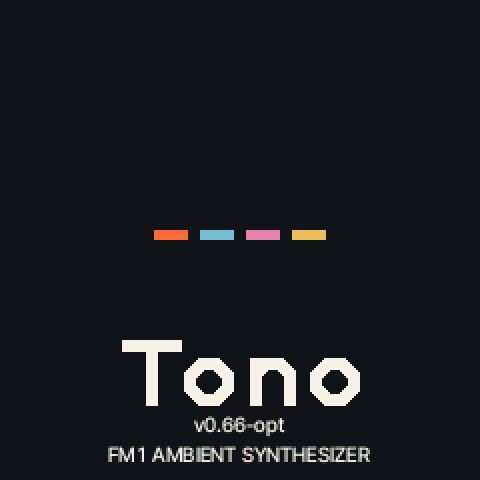

  

# Tono

Open-source generative ambient firmware for the M-VAVE FM-1. Four layers share an instrument engine, with independent sounds, modulation, effects and sequencing.

- **Play** · Garden opens at startup. Explore the factory arrangements, Generate presets, the A22 sound bank and sampled textures.
- **Perform** · Turn ALGORITHM on HOME to travel through the piece. Hold HOME and turn it with a layer selected to evolve that layer. Use HOME + EDIT for contextual help.
- **Watch** · The Contour and Train Ride displays respond to the music. Choose Studio Dark, Studio Light or Dial in GLO.

**[Play in your browser](https://pietrobolcato.github.io/tono/)** · [Download firmware or the macOS emulator](https://github.com/pietrobolcato/tono/releases) · [Install and recover](docs/tono/INSTALL.md) · [Controls](ambplus/CONTROLS.md) · [Build from source](docs/tono/BUILD.md)

Read the [architecture notes](docs/tono/ARCHITECTURE.md) and [release history](docs/tono/releases/) to get oriented. Report issues with your Tono version, steps to reproduce, and whether it occurs on hardware or in the emulator.

Tono builds on Juan Jiant’s JIANT FM, Leo Kuroshita’s Felucca and Charles Vestal’s fm1-amb. The firmware is GPL-3.0-only, with separate notices for incorporated code, fonts and recordings. [Licensing and credits](LICENSING.md)
