# Tono

[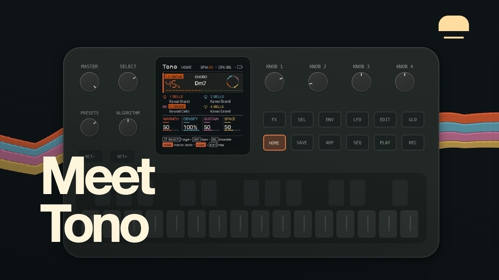](https://www.youtube.com/watch?v=IzsMZwEzl6E)

**A four-layer ambient instrument for the M-VAVE FM-1.** Four-layer instrument for making music that evolves as you play. Start with a single sound, bring in another, and decide how much of the piece you want to play yourself and how much you want to leave to Tono.

A bassline can become a drum pattern. A piano phrase can find a different ending each time it comes around. Shape a sound with effects, write your own sequence, or let a favourite combination play for a while and hear where it goes. Each layer has its own voice, effects and sequencer.

**[Introducing Tono (2:06)](https://www.youtube.com/watch?v=IzsMZwEzl6E)** · **[Play Tono in your browser](https://pietrobolcato.github.io/tono/)** · **[Get the firmware for free](https://github.com/pietrobolcato/tono/releases/latest)**

## Demo - listen

| [Morning Session](https://www.youtube.com/watch?v=UJ1czSA0C08) | [Acid Ambient](https://www.youtube.com/watch?v=EIN45Fl_-m4) | Ambient Piano After Dark |
| --- | --- | --- |
|  | [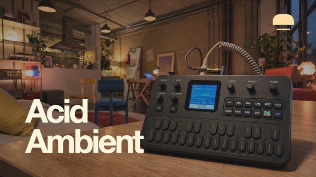](https://www.youtube.com/watch?v=EIN45Fl_-m4) | 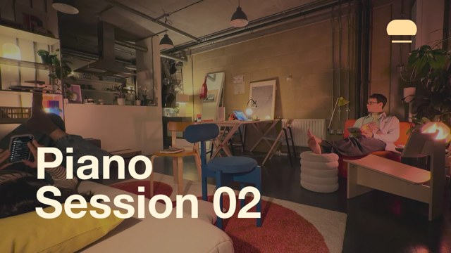 |
| Four-hour live session | Sound study · 14:24 | Upcoming · 15:24 |

Find us on [Unhurried Machines on YouTube](https://www.youtube.com/@unhurriedmachines).

## Features

| Feature | What you can do | Screen reference |
| --- | --- | --- |
| **Four independent layers** | Give any layer one of eight roles. Choose Pad, Drone, Bells, Bass, Drums, Texture, Sample or Lead. Double up on a favourite sound, mix the four layers in Ensemble, or change one layer’s role as the others play. | <a href="docs/tono/media/screens/layers.png">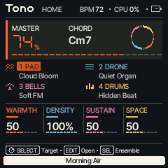</a> |
| **Sound banks and variations** | Play acid bass, A22 electric keys and analogue voices, FM tones, vowel choirs, field textures and sampled instruments including Kawai grand piano, bowed cello, violin, sax and flute. Browse variations of the current patch to change its tone, playing response and effect sends. | <a href="docs/tono/media/screens/sound-preview.png">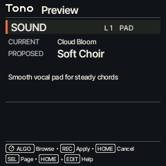</a> |
| **Auto and manual sequencing** | Let each layer generate a part, or capture its current 16-step phrase and edit individual pitches, rests and velocities. Add acid accents and slides, or tap a pattern into four drum lanes. Switching back to Auto preserves your manual pattern. | <a href="docs/tono/media/screens/drum-pattern.png">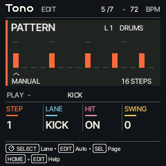</a> |
| **Rhythm, phrase and interplay** | Pair Euclidean pulses or odd loops with a phrase rule. Locked Loop repeats a motif, Drift Loop occasionally replaces a note, and Markov Walk learns short transitions between notes. Adjust variation, swing, speed, density and the way layers play together. | <a href="docs/tono/media/screens/generate.png">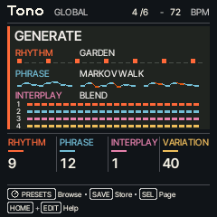</a> |
| **Harmony and Auto Travel** | Choose a key and scale, edit the shared note pool on the keyboard, or let chords evolve over a chosen number of bars. Turn ALGORITHM to evolve the piece live. Auto Travel can change sounds, roles and patterns on a schedule, using adjustable release tails or crossfades. | <a href="docs/tono/media/screens/harmony.png">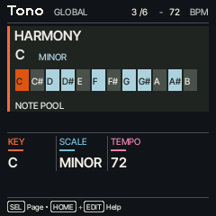</a> |
| **Synthesis and modulation** | Edit the sound engine, ADSR envelope, glide, register and pan. Two LFOs per layer can move sound, filter and effect parameters at fixed, tempo-linked or random rates. Turn a control and use HOME + LFO to assign it. | <a href="docs/tono/media/screens/modulation.png">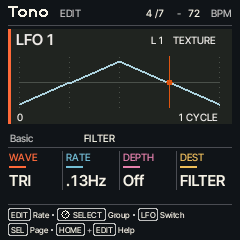</a> |
| **Filters and EQ** | Sweep a resonant low-pass or high-pass, isolate a band with band-pass, or cut and boost with a bell. Low-pass and high-pass slopes run from 6 to 24 dB per octave. Layer and master EQ show the live spectrum beneath the curve. | <a href="docs/tono/media/screens/layer-eq.png">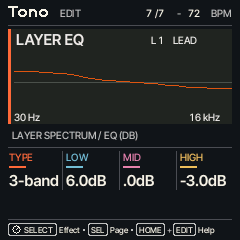</a> |
| **Effects and mixing** | Shape individual layers with drive, chorus, auto-pan, stereo tremolo, granular processing, spatial effects, and sends to delay and reverb. Compare the dry and processed mix. Set the master limiter’s peak ceiling and release. | <a href="docs/tono/media/screens/effects.png">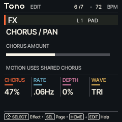</a> |
| **Sampling and recording** | Choose a factory recording or capture a short sample over USB. Trim, transpose and fade it, play it once, or loop it forwards, backwards or in alternating directions. Record the stereo mix over USB. | <a href="docs/tono/media/screens/sample.png">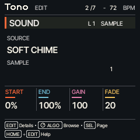</a> |
| **Presets and recall** | Start with a factory arrangement or a Generate recipe. Save eight user songs with their sounds, patterns and mix, plus four user Generate recipes. Recall a saved composition during playback at the next bar. | <a href="docs/tono/media/screens/preset.png">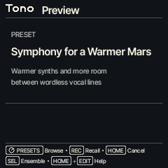</a> |
| **Performance views** | Watch four layer meters in Ensemble or see Contour and Train Ride respond to the music. Choose Studio Dark, Studio Light or Dial. HOME + EDIT opens help for the current controls. | <a href="docs/tono/media/screens/train-ride.png">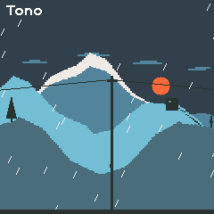</a> |

[Full control reference](ambplus/CONTROLS.md) · [On-device help](docs/tono/HELP.md)

## Play your first piece

1. Open the browser player, click **Start**, then **PLAY**. The first arrangement is *Garden*.
2. On **HOME**, turn **SELECT** to choose a layer. Turn **MASTER** to fade that layer in or out. Try leaving the pad ringing while you bring the bass back.
3. Turn **ALGORITHM** to evolve the piece. To evolve just the selected layer, hold **HOME** while turning **ALGORITHM**. Press **HOME + EDIT** for help with the current screen.

Explore the factory arrangements, Generate presets, A22 sound bank and sampled textures. In **GLO**, choose Studio Dark, Studio Light or Dial. The Contour and Train Ride displays respond to the music. [Controls](ambplus/CONTROLS.md) · [Help screens](docs/tono/HELP.md)

## Install on an FM-1

Tono targets the **M-VAVE FM-1**. Release **v0.74.2-opt** recognises two flash chips for saving songs and settings. Check the flash ID reported by FM-SWITCH before writing.

| Flash chip | JEDEC ID |
| --- | --- |
| Puya P25Q80 | `0x856014` |
| UCUN UC25HQ80 | `0xB36014` |

1. Download the versioned **.fwsc** and **SHA256SUMS** from the same release. On macOS, run `shasum -a 256 tono-0.74.2-opt.fwsc` and compare the result with the entry for that file. [Release files and evidence](https://github.com/pietrobolcato/tono/releases/tag/v0.74.2-opt)
2. In **FM-SWITCH**, make a whole-flash backup, keep a separate copy and export recordings you want to keep. Check your recovery route first. A stock M-VAVE bootloader can require a **USB_KEY** if the application fails to start. [FM-SWITCH](https://fm-1.drewr.dev/fm-switch/) · [Install and recover](docs/tono/INSTALL.md)
3. Import the **.fwsc**. To keep songs and settings, leave **Start the new firmware fresh** unchecked. Confirm product **FM-1_900** and application writes within **0x04000–0x92FFF**. Stop if the product, flash ID or write range differs from the values above.
4. Keep power and USB connected until verification finishes. After restart, check the version on the startup screen, play at low volume and recall a saved song.

**On an Apple silicon Mac**, download and extract the macOS ARM64 emulator bundle and run `./launch-emulator.sh` from the extracted folder. It runs the released firmware and keeps its saved state on your Mac. [Downloads](https://github.com/pietrobolcato/tono/releases/latest)

## Inside Tono

Tono builds on Juan Jiant’s **JIANT FM**, Leo Kuroshita’s **Felucca** and Charles Vestal’s **fm1-amb**. The firmware is GPL-3.0-only, with separate notices for incorporated code, fonts and recordings. [Licensing and credits](LICENSING.md)

[Build from source](docs/tono/BUILD.md) · [Architecture](docs/tono/ARCHITECTURE.md) · [Release history](docs/tono/releases/)

If you report an issue, include your Tono version, the steps to reproduce it and whether you were playing on hardware or in the emulator.
